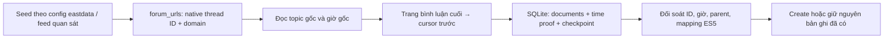

# Forum flow dựa trên eastdata — 17/11/2026

Phạm vi là 21 domain có hoạt động công khai được xác nhận ở lượt kiểm tra trước. Registry ở `config/forum-flow/sites.json`; 11 domain có config eastdata được đọc trực tiếp, lưu đường dẫn và SHA-256. Các domain không có config cũ dùng adapter theo HTML/state/JavaScript thực đã lưu trong `outputs/forum-flow-evidence-2026-11-17`. Không chạy code Node 0.12 hay `eval` các expression trong config cũ.

## Flow cũ đã đọc

- `../eastdata/scripts/forum/get-forum-post-urls.js`: producer theo lượt; lượt đầu toàn bộ site, bốn lượt kế ưu tiên site `priority=1`; chủ động đặt `max_retries=0` và chờ lượt sau.
- `../eastdata/scripts/forum/workers/get-forum-post-urls-worker.js`: dùng `seed_url`/`seed_urls`, parser lấy link, insert/update `ForumUrls` về `processed=0`; downloader có fallback.
- `../eastdata/scripts/forum/queue/workers/get-forum-urls-worker.js`: biến thể queue, phân trang seed và so mốc activity.
- `../eastdata/scripts/forum/get-forum-comments.js` và `workers/get-forum-comments-worker.js`: đọc batch URL chưa xử lý, lấy bài gốc, lấy bình luận từ trang cuối lùi về `last_page_num`, lưu `last_page`, `last_updated_at`; bài đầu trang sau là bình luận, không phải topic mới. Nhánh master hiện hardcode VOZ; nhánh khác vẫn dùng registry.
- `../eastdata/scripts/forum/lib/parser.js`: selector theo site, permalink, author, created_time, pagination; có `moment` theo timezone máy, thay Today/Yesterday bằng giờ chạy và expression `eval`.
- `../eastdata/models/forum/{urls,posts,comments}.js`: các kho lưu URL/topic/comment trước bước index.
- `../eastdata/scripts/elasticsearch/{index-posts,index-comments}.js`: index `forumTopic`/`forumComment`, ID MD5 URL/permalink; comment có `parentId` MD5 URL topic và `parentDate` ngày gốc topic. Đây là ID ES, khác ID trung gian Mongo từng dùng hash title.

## Phần giữ nguyên và phần sửa có căn cứ



Giữ hai bước discovery và topic/comments, URL được đưa lại vào queue khi xuất hiện hoạt động; giữ ưu tiên 1 lượt toàn bộ/4 lượt priority. Registry vẫn mang seed cũ. Các URL feed có search ID tạm được rút về entry point công khai đã quan sát để không quét mãi một kết quả tìm kiếm đóng băng. Otofun thêm alias `www.otofun.net.vn` theo redirect thực.

Kho URL và documents chuyển sang SQLite WAL của riêng forum để chạy cùng Node22 hiện tại; giữ các trường cursor/processed tương ứng, không phụ thuộc Mongo/Redis của eastdata. Collector và ES writer là hai tiến trình độc lập, có lease riêng; writer hỏng không làm mất dữ liệu collector.

Sửa những vấn đề đã thấy trong code/thực nghiệm:

1. Thời gian theo timezone máy và chuỗi tương đối có thể lệch ngày. Dùng timestamp native hoặc giờ tuyệt đối có chứng cứ; thiếu giờ không lấy giờ crawl thay thế.
2. `getLatestPostOnPage` cũ dùng tên đơn vị `s`/`ms` ngược với phép chuyển đổi. Luồng mới đặt rõ `seconds`/`milliseconds`. XenForo2 có `data-time="22:09"`, Unix time nằm ở `data-timestamp`; không đọc nhầm hai trường này.
3. Có nhánh lỗi vẫn cập nhật `processed=1`. Luồng mới giữ pending/lỗi, không chốt cursor nếu download, parse hay transaction thất bại.
4. Bài đầu trang sau không thành topic mới; xác định bằng position/#thứ tự thực, bao gồm số có dấu phân tách hàng nghìn trên GameVN.
5. Backfill bị giới hạn trang có `resume_url`, `target_last_page`, `scan_floor_page`; trang mới xuất hiện trong lúc backfill không làm nhảy mất khoảng chưa đọc. Vòng incremental đọc chồng một trang quanh cursor cũ, dedup bằng native ID.
6. Mốc 7 ngày trong worker cũ không phù hợp khoảng đã yêu cầu từ đầu tháng 10. Mặc định mới là **01/10/2026 00:00:00 UTC+07**, tương đương **30/09/2026 17:00:00Z**. Đổi cửa sổ phải dùng state mới. Topic cũ được giữ làm context cho reply mới; không export topic cũ không có reply trong cửa sổ.
7. DFF dựng bộ đếm `0` ban đầu rồi gọi AJAX; không coi số placeholder là đã xác nhận không có bình luận. Đọc `LoadView.ashx?t=9` đúng như frontend.
8. Master ES5 thực tế refresh mỗi 60 giây. `refresh=wait_for` vượt RPC30s có thể trả timeout dù đã ghi. Canary đã được đọc lại để đối soát; bản cuối dùng refresh xác nhận cho create. Không đổi refresh interval của master.

## Hợp đồng thời gian

- Lưu UTC ISO trong ES, tính tuần ISO theo UTC+07 như helper đã được đối soát với master cũ. Lưu raw timestamp, kind, precision, nguồn và timezone trong proof SQLite.
- Unix seconds không cộng/trừ 7 giờ lần nữa. ISO có offset được chuyển trực tiếp. Chỉ chuỗi giờ địa phương không offset mới áp UTC+07 theo cấu hình VN/Thái Lan.
- Pantip: năm Phật lịch trừ543 bằng adapter riêng; thời gian topic loại `.edit-history`; comment/reply lấy đồng hồ riêng, đối chiếu epoch khi có.
- XenForo: chỉ lấy thời gian từ attribution của chính post; không lấy thời gian sửa, quote, chữ ký hay sidebar. Native timestamp và title được so đến precision hiển thị; xung đột giữ lỗi.
- Tinhte: chỉ lấy `post_create_date` từ post thuộc thread matching trong public `__NEXT_DATA__`; không dùng giờ crawl hay thread ngày mới nhất cho reply.
- Bovagau: `post.publishedAt` seconds khớp `article:published_time`; không dùng `updatedAt`.
- DFF/WN/WordPress: original `article:published_time` thuộc bài; meta trùng phải cùng instant. OFFB: `datePublished` wall clock, không dùng `dateModified`.
- Reject ngày lịch không hợp lệ, thiếu clock, thiếu offset ở ISO, relative-only và thời gian vượt hiện tại quá5phút. Không đoán năm từ chuỗi thiếu năm.
- `parentDate` luôn là ngày gốc topic; `publishedDate` của reply là giờ reply. Mỗi reply nằm trong tuần của chính nó, có thể khác tuần topic.

## Ghi ES5 và đối soát

`preflight_forum_es5.mjs` đã đối chiếu read-only 3 topic +3 comment thật: 6/6 khớp MD5 latin1 và tuần index; proof gắn fingerprint cluster. Writer kiểm tra đúng cluster, mapping và proof giờ trước create.

Tra URL/scheme/www/alias và native ID trong namespace site/type trước ghi. Nhiều identity hoặc query thiếu kết quả được giữ để review. Topic được đối soát trước comment; native thread ID dùng để bind parent, không nhầm với ID post đầu. Bản ghi cũ giữ nguyên ID, index, insertedDate và counters. Không sửa ngày lịch sử khi lệch giờ. Parent của comment được đổi sang ID/date của topic ES đã đối soát.

Sau create có đối soát lại; race tạo duplicate chỉ được rollback bản mới của chính flow với version/source/insertedDate còn khớp. Không xóa hay hợp nhất bản ghi lịch sử tự động.

## Lệnh chạy và vận hành

```powershell
node --test test/forum-flow.test.mjs test/forum-es5.test.mjs test/news-forum-parser.test.mjs
node scripts/run_forum_flow.mjs --output outputs/forum-flow --max-topics-per-site 4 --max-thread-pages 10
node scripts/preflight_forum_es5.mjs
node scripts/run_forum_writer.mjs --state outputs/forum-flow/state.sqlite --limit 10
```

Writer mặc định chỉ đối soát. `--write` bật create; `--continuous` chạy liên tục. Collector mặc định một lượt, `--continuous` bật lịch; `--sites` lọc domain. HTML chứng cứ của bản cuối là gzip theo SHA-256 nội dung, tránh ghi đè chứng cứ cũ; URL error và coverage được lưu riêng.

Ngày 17/11 bổ sung parser XenForo cho video-only dùng `data-s9e-mediaembed-iframe`: đọc JSON thuộc tính `src`, giữ attachment và giờ attribution của chính post, không chạy JavaScript. Ba trang Otofun từng bị `topic_required_fields_missing` đã parse đủ trên HTML chứng cứ (20/20/14 posts).

Writer liên tục dùng `ForumBulkEs5Sink`: gom các bản ghi cùng role, hoàn thành topic trước comment, đối soát identity theo lô trước và sau `bulk create` với một refresh cho cả lô. Vẫn giữ kiểm tra mapping/clock/parent, kết quả từng item, incomplete search và rollback chỉ bản mới của flow khi đụng race. Lô production là 10; không đổi refresh interval của master. Thử lô 50 vượt timeout nên đã trả các bản ghi thử về pending để đối soát lại, không coi là đã ghi thành công. Có thời gian xử lý lô trong `writer-report.json`.

Release `/opt/forum-flow/releases/20261117-bulk-1794920612`; backup state trước đổi tại `/var/backups/forum-flow/pre-bulk-1794920634.sqlite`. 43 tests local đạt, 39 tests tương ứng đạt trên VPS. Sau điều chỉnh batch, lô 10 create đạt 21.153ms (~28,4 records/phút, chưa tính nghỉ 1s); đây là đo ngắn, không phải SLA. Cả ba cursor lỗi đã đi tiếp (topic1969529 hoàn tất,1886102 đi từ182 xuống164,1934886 từ1090 xuống1072). 103 record của lượt batch lớn đã được requeue, held còn144 là các trường hợp identity/time/parent cần đối soát;10record đọc lại ES khớp giờ và parent. Chứng cứ tại `outputs/forum-performance-2026-11-17` và snapshots `outputs/forum-progress`.

Theo yêu cầu bulk100 tiếp theo, cấu hình production hiện là **100** (`--limit 100`), release `/opt/forum-flow/releases/20261117-bulk100-1794921168`. Identity candidate query gộp URL aliases/IDs và gộp numeric scans thành một regexp automaton cho mỗi site, thay vì lặp wildcard scan cho từng record; vẫn lọc lại native identity, namespace và yêu cầu search đầy đủ. Timeout RPC120s, timeout search90s; không đổi master refresh interval. 46 tests local đạt; bộ VPS đạt. Lô thật100create đã xác nhận đủ100/100 trong21.142ms (~284records/phút trước khoảng nghỉ1s), held không tăng. Đây là thời gian một lô, không phải SLA. Backup state `/var/backups/forum-flow/pre-bulk100-1794921188.sqlite`; collector giữ nguyên PID, chỉ restart writer.

Unit collector/writer ở `deploy/forum-flow*.service`. Forum hiện chạy trên **148.113.144.41**, dùng Node22 riêng tại `/opt/forum-flow/node/bin/node`, user/state/env/service forum riêng. Collector giới hạn50%CPU/512MiB; writer25%CPU/256MiB. Chỉ dùng ES5_HOST hiện có, không sửa news release, news services, `/etc/news-flow/ai.env` hoặc database `ai_usage`. Không có API AI trả phí trong luồng forum này.

**Đã chuyển từ139.99.192.72 sang148.113.144.41 ngày17/11/2026 theo yêu cầu user.** `forum-flow.service` và `forum-flow-writer.service` trên148 đều active/enabled, release `/opt/forum-flow/releases/20261117-01`, state `/var/lib/forum-flow/runtime/state.sqlite`. Bộ31test và preflight6mẫu thật đạt trên máy mới trước cutover. State trước khi bật khớp SHA-256 và counts:6867documents/2706URLs/490pages/1508events/285ESbindings. Raw clock/tuần index/parent của toàn bộ6867record không lệch; đọc lại2topic+2reply ES khớp. Source đã stop/disable rồi xóa2unit và `/opt/forum-flow`, `/var/lib/forum-flow`, `/etc/forum-flow`; ba service news trên139 giữ nguyên PID/start time/restarts và `ai.env` không đổi. Backup chuyển máy nằm trên148 tại `/var/backups/forum-flow` (root-only). Biên bản chuyển máy ở `outputs/forum-move-2026-11-17`; biên bản cài ban đầu tại139 giữ trong `outputs/forum-deploy-2026-11-17` làm lịch sử.

## Giới hạn có bằng chứng

- VOZ từng chặn HTTP/headless trên máy local; trên VPS đã lấy được topic và bình luận thật. Không dùng kết quả khả dụng local để kết luận cho VPS hoặc ngược lại; health report ghi riêng từng nguồn.
- Bovagau đọc được topic/public state, nhưng API comment thử không session trả403 `invalid token`. Topic có totalComments>0 giữ incomplete; mẫu zero comments có thể hoàn thành. Không tự lấy token hay dựng comment.
- DFF đã xác minh endpoint stats; topic có bình luận thực >0 giữ incomplete nếu chưa xác minh HTML/cursor của chúng. Mẫu đã chạy stats đều0.
- WN/Pantip lấy bình luận qua endpoint đọc thật đã quan sát. Khi replies embedded chưa đủ so với counter, giữ incomplete; không tuyên bố đủ replies lồng nhau.
- Tinhte chỉ hoàn thành khi tập native posts khớp total hoặc có link phân trang công khai đọc được. Không đoán private endpoint để bù phần thiếu.
- Seed/crawl có cap và checkpoint; lượt kiểm chứng chỉ lấy mẫu. Chưa khẳng định đã backfill toàn bộ lịch sử01/10–17/11 của21site hoặc đạt SLA toàn site. File summary phân biệt URL chưa đọc, lỗi, incomplete và complete trong cửa sổ cấu hình.
